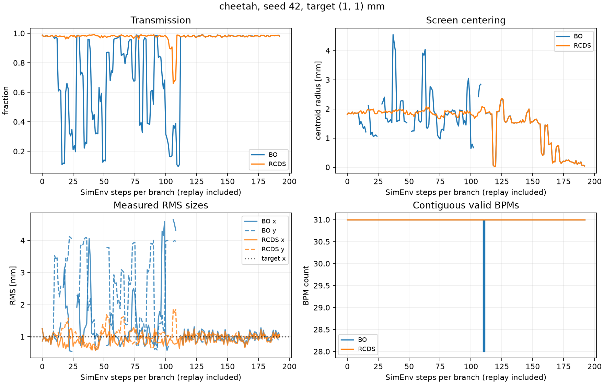
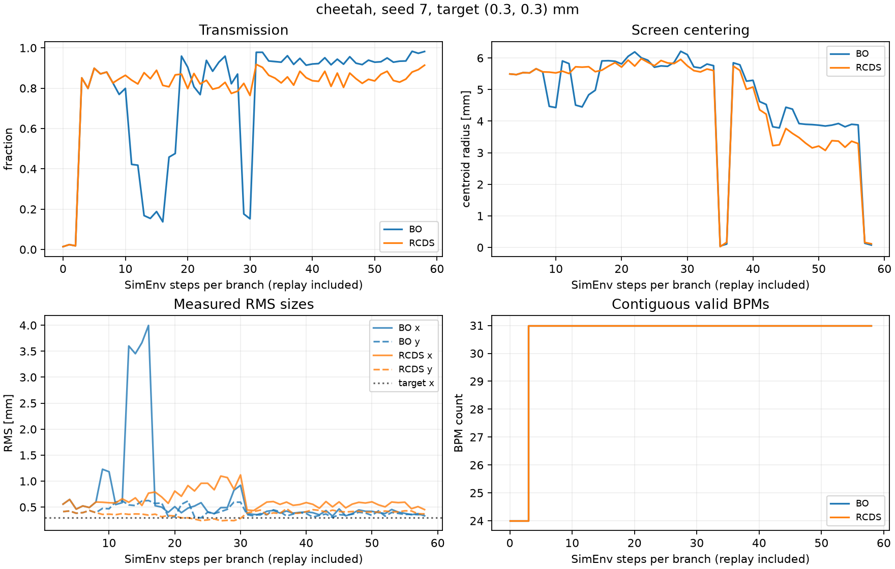

# Validation results

Executed on 2026-10-15. All cases use L4H as a drift, powered VBC, apertures enabled, live per-step beam jitter and 0.1% supply ripple. The two methods start from replayed threading settings; these are small validation cases, not a statistical ranking.

| Case | Particles / repeats | Method | Final transmission | Final σx, σy [mm] | Final μx, μy [mm] |
|---|---:|---|---:|---|---|
| [nominal_seed42](results/nominal_seed42/summary.json) | 10000 / 3 | BO | 98.42% | 1.064, 0.980 | 0.023, -0.038 |
| [nominal_seed42](results/nominal_seed42/summary.json) | 10000 / 3 | RCDS | 98.35% | 1.014, 1.023 | 0.020, -0.038 |
| [xsuite_validation](results/xsuite_validation/summary.json) | 1000 / 2 | BO | 98.40% | 1.043, 0.927 | -0.038, -0.031 |
| [xsuite_validation](results/xsuite_validation/summary.json) | 1000 / 2 | RCDS | 98.25% | 0.876, 1.055 | -0.038, -0.037 |
| [threading_stress_final](results/threading_stress_final/summary.json) | 1000 / 2 | BO | 97.75% | 0.354, 0.362 | -0.091, 0.052 |
| [threading_stress_final](results/threading_stress_final/summary.json) | 1000 / 2 | RCDS | 90.30% | 0.482, 0.371 | -0.128, 0.052 |

The nominal Cheetah case requests (1, 1) mm, uses the default 35 optics and 25 centering objective evaluations, and records 393 shots including discovery, replay, restoration, verification and reset shots. It confirms that noisy BO and RCDS both execute within the five-mode quadrupole subspace, then center with only the final four corrector channels.

The Xsuite case requests (1, 1) mm with shorter 12/10 optics/centering budgets. Its beta response is computed with Xsuite transfer-map tracking. It records 111 shots including resets.

The stress case requests (0.3, 0.3) mm and multiplies the normal survey/diagnostic uncertainty by five. The initial beam reaches only 24 of 31 BPMs, with 1.4% initial transmission; threading recovers all 31 BPMs and a valid IP reading before either optics branch. It uses 12/12 optics/centering budgets and records 125 shots including resets. Maximum replay discrepancies relative to discovery were 34.9 µm in each branch; the two branch starts were identical.

All three saved runs pass `verify_run.py`: the measured quadrupole vectors stay in their declared affine subspaces, centering actions contain only the final four channels, repeated settings produce different readings, and shot counters reconcile. Every case records exact equality of the two branch-start BPM vectors. The final centroids/sizes above are independent verification averages, so their errors need not equal the best noisy search measurement.

The finite-difference relative changes between the Richardson beta response and its coarse estimate are recorded in each `optics_response.npz`; they are about 10⁻⁶ for these examples. The seven bound/missing-signal/objective unit tests pass. The six `orbit_matching.test_compatibility` tests also pass after restoring the shared provider and legacy import and recalibrating both 144-node backend grids.

